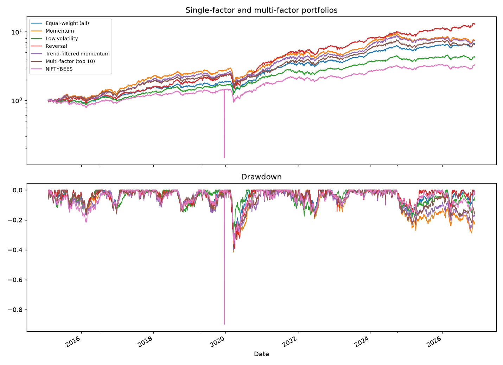
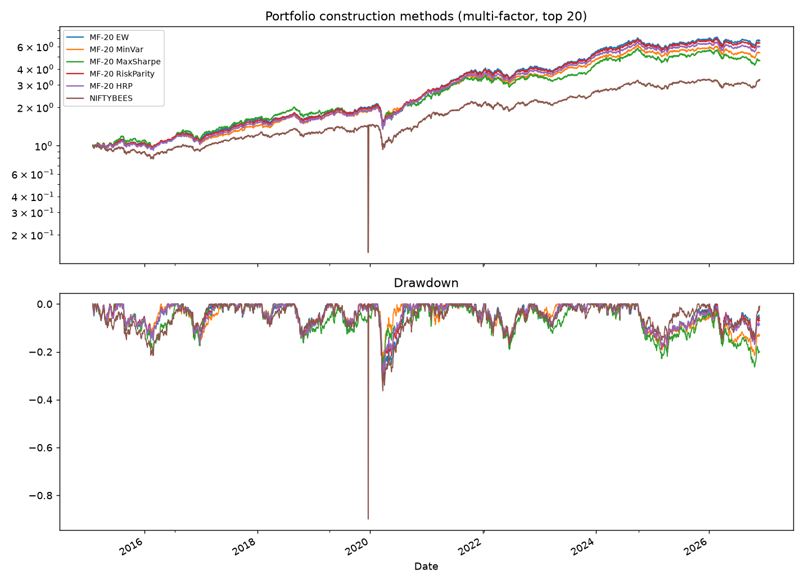
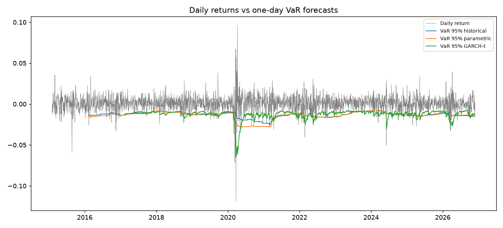
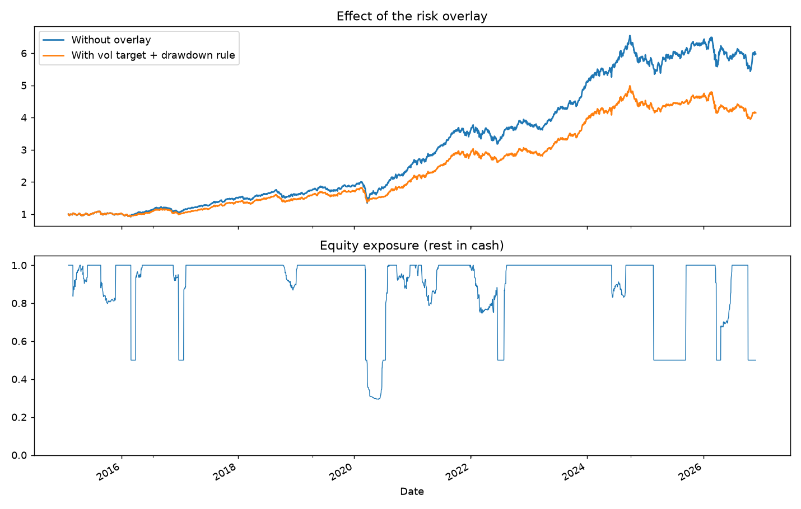
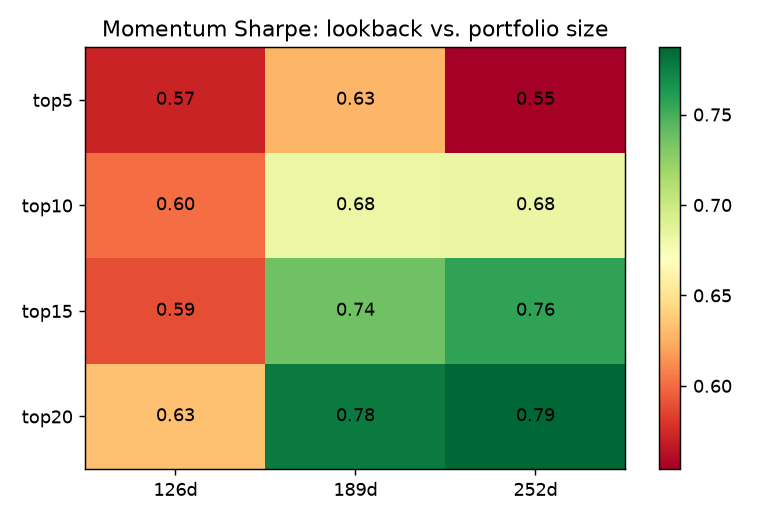
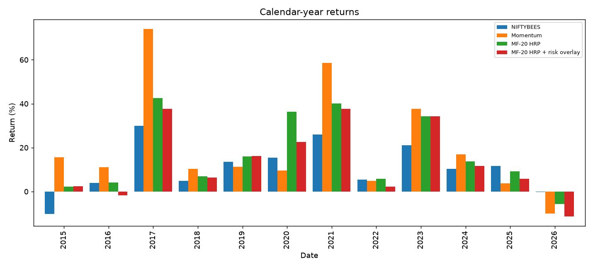

# Systematic Multi-Factor Portfolio Framework: Nifty 50

*Auto-generated. Sample: 2015-02-02 to 2026-11-26 (11.6 years), 46 stocks, benchmark NIFTYBEES. Costs: 10 bps per unit of turnover. Risk-free rate 6%.*

## 1. Performance (net of costs)

| |CAGR|Volatility|Sharpe|Sortino|Max Drawdown|Calmar|Annual turnover|
|---|---|---|---|---|---|---|---|
| Equal-weight (all) |17.9%|15.9%|0.74|1.01|-36.3%|0.49|64.1%|
| Momentum |19.0%|19.6%|0.68|0.93|-41.6%|0.46|600.3%|
| Low volatility |13.4%|13.9%|0.54|0.76|-28.1%|0.48|472.4%|
| Reversal |24.7%|19.4%|0.93|1.33|-39.3%|0.63|1989.1%|
| Trend-filtered momentum |18.9%|19.1%|0.69|0.94|-40.0%|0.47|634.7%|
| Multi-factor (top 10) |17.5%|17.4%|0.67|0.92|-38.0%|0.46|1069.3%|
| MF-20 EW |17.8%|16.0%|0.73|1.01|-36.1%|0.49|797.6%|
| MF-20 MinVar |15.6%|14.1%|0.67|0.95|-28.4%|0.55|952.6%|
| MF-20 MaxSharpe |14.2%|16.3%|0.53|0.74|-31.9%|0.44|774.7%|
| MF-20 RiskParity |17.4%|15.1%|0.74|1.02|-33.7%|0.52|822.3%|
| MF-20 HRP |16.7%|14.8%|0.71|0.99|-32.9%|0.51|928.7%|
| MF-20 HRP + risk overlay |13.1%|12.5%|0.57|0.77|-24.7%|0.53|928.7%|
| NIFTYBEES |10.9%|265.4%|0.28|2.63|-89.9%|0.12||

## 2. Portfolio construction: same stock picks, different weighting

| |CAGR|Volatility|Sharpe|Max Drawdown|Calmar|
|---|---|---|---|---|---|
| MF-20 EW |17.8%|16.0%|0.73|-36.1%|0.49|
| MF-20 MinVar |15.6%|14.1%|0.67|-28.4%|0.55|
| MF-20 MaxSharpe |14.2%|16.3%|0.53|-31.9%|0.44|
| MF-20 RiskParity |17.4%|15.1%|0.74|-33.7%|0.52|
| MF-20 HRP |16.7%|14.8%|0.71|-32.9%|0.51|
| MF-20 HRP + risk overlay |13.1%|12.5%|0.57|-24.7%|0.53|
| NIFTYBEES |10.9%|265.4%|0.28|-89.9%|0.12|

## 3. Benchmark-relative statistics (CAPM regression)

| |Alpha (ann.)|Alpha t-stat|Beta|Tracking error|Information ratio|Up capture|Down capture|
|---|---|---|---|---|---|---|---|
| Equal-weight (all) |11.5%|2.40|0.00|265.1%|-0.24|0.56|0.88|
| Momentum |13.1%|2.27|0.00|265.2%|-0.23|0.59|0.93|
| Low volatility |7.3%|1.72|0.00|265.2%|-0.25|0.43|0.68|
| Reversal |17.8%|3.15|0.00|265.2%|-0.22|0.61|0.91|
| Trend-filtered momentum |12.9%|2.30|0.00|265.2%|-0.23|0.56|0.88|
| Multi-factor (top 10) |11.4%|2.18|0.00|265.1%|-0.24|0.53|0.84|
| MF-20 EW |11.5%|2.41|0.00|265.1%|-0.24|0.53|0.83|
| MF-20 MinVar |9.3%|2.18|0.00|265.1%|-0.25|0.44|0.68|
| MF-20 MaxSharpe |8.4%|1.70|0.00|265.2%|-0.25|0.47|0.75|
| MF-20 RiskParity |11.0%|2.42|0.00|265.1%|-0.24|0.50|0.78|
| MF-20 HRP |10.3%|2.33|0.00|265.1%|-0.24|0.48|0.76|
| MF-20 HRP + risk overlay |6.9%|1.80|0.00|265.1%|-0.26|0.42|0.67|

## 4. Risk layer

Full-sample one-day 95% VaR of MF-20 HRP: -1.35%; CVaR: -2.09%.

**VaR forecast backtest** (95% VaR should be breached on about 5% of days; a small Kupiec p-value means the model's breach rate is statistically off):

| |Days|Breaches|Breach rate|Expected rate|Kupiec p-value|
|---|---|---|---|---|---|
| historical |2664.00|142.00|5.3%|5.0%|0.44|
| parametric |2664.00|134.00|5.0%|5.0%|0.94|
| GARCH-t |2416.00|148.00|6.1%|5.0%|0.01|

**Volatility targeting and drawdown de-risking:**

**Stress windows** (cumulative return; windows are approximate):

| |NIFTYBEES|Equal-weight (all)|Momentum|Multi-factor (top 10)|MF-20 HRP|MF-20 HRP + risk overlay|
|---|---|---|---|---|---|---|
| 2018 Aug-Oct selloff |-13.8%|-12.0%|-10.8%|-12.8%|-13.9%|-13.9%|
| COVID crash |-34.4%|-35.0%|-40.8%|-37.0%|-31.9%|-23.7%|
| 2021-22 rate-hike selloff |-16.1%|-14.7%|-15.8%|-13.2%|-13.8%|-11.9%|
| 2024-25 drawdown |-9.7%|-12.0%|-21.3%|-17.6%|-13.1%|-13.8%|
| Worst single day |-89.9%|-12.2%|-15.0%|-13.5%|-11.9%|-7.0%|

## 5. Validation

**Parameter sensitivity** (momentum Sharpe). A trustworthy signal works across neighbouring settings rather than at one lucky point.

**Transaction-cost sensitivity:**

| |CAGR|Sharpe|
|---|---|---|
| ('Momentum', '0 bps') |19.8%|0.71|
| ('Momentum', '10 bps') |19.0%|0.68|
| ('Momentum', '20 bps') |18.3%|0.65|
| ('Momentum', '30 bps') |17.6%|0.62|
| ('Momentum', '50 bps') |16.2%|0.56|
| ('MF-20 HRP', '0 bps') |17.8%|0.78|
| ('MF-20 HRP', '10 bps') |16.7%|0.71|
| ('MF-20 HRP', '20 bps') |15.6%|0.65|
| ('MF-20 HRP', '30 bps') |14.6%|0.59|
| ('MF-20 HRP', '50 bps') |12.5%|0.46|

**Walk-forward test** (parameters chosen on past data only, then traded on the next unseen year):

| |CAGR|Volatility|Sharpe|Max Drawdown|
|---|---|---|---|---|
| Walk-forward momentum (OOS) |14.7%|18.7%|0.51|-41.6%|
| Fixed 252d/top10 momentum |14.9%|20.2%|0.49|-41.6%|
| Equal-weight (all) |18.3%|16.5%|0.74|-36.3%|
| NIFTYBEES |11.7%|307.3%|0.32|-89.9%|

| |Test period start|Chosen params|Train Sharpe (daily)|
|---|---|---|---|
| 0 |2018-02-02|252d/top10|0.10|
| 1 |2019-02-02|252d/top10|0.09|
| 2 |2020-02-02|252d/top10|0.08|
| 3 |2021-02-02|189d/top20|0.07|
| 4 |2022-02-02|252d/top20|0.08|
| 5 |2023-02-02|189d/top20|0.07|
| 6 |2024-02-02|252d/top20|0.08|
| 7 |2025-02-02|252d/top20|0.08|
| 8 |2026-02-02|252d/top20|0.08|

**Block-bootstrap Sharpe ratios** (90% interval; P = chance the strategy's Sharpe beats the benchmark's across resampled histories):

| |Sharpe|5th pct|95th pct|P(Sharpe > benchmark)|
|---|---|---|---|---|
| NIFTYBEES |0.28|-0.05|0.73||
| Equal-weight (all) |0.74|0.22|1.29|0.94|
| Momentum |0.68|0.19|1.19|0.91|
| Multi-factor (top 10) |0.67|0.17|1.21|0.90|
| MF-20 HRP |0.71|0.21|1.26|0.93|
| MF-20 HRP + risk overlay |0.57|0.05|1.13|0.81|

**Calendar-year returns:**

## 6. Automatic observations (read critically)

- Highest full-sample Sharpe: **Reversal** (0.93) vs benchmark 0.28. Picking the best of many strategies in-sample overstates its true skill (multiple testing).

- Strategies with higher Sharpe than the benchmark: 12 of 12.

- Strategies with |alpha t-stat| > 2: Equal-weight (all), Momentum, Reversal, Trend-filtered momentum, Multi-factor (top 10), MF-20 EW, MF-20 MinVar, MF-20 RiskParity, MF-20 HRP.

- Survivorship bias is present: the universe is today's index members, which flatters every stock-picking result relative to the benchmark.
